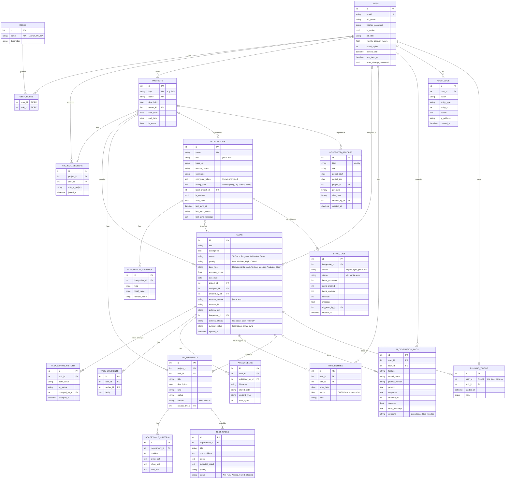

# BA WorkTrack: database ER diagram

GitHub draws this diagram automatically when you open the file on github.com.
In VS Code, install the "Markdown Preview Mermaid Support" extension and press Ctrl+Shift+V.

How to read the lines: `||--o{` means "one ... to zero or more". For example, one
TASK has zero or more TIME_ENTRIES, and each time entry belongs to exactly one task.
`created_at` / `updated_at` columns are left out to keep the picture readable.

